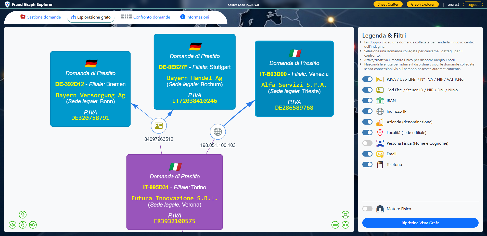

# Fraud Graph Explorer

Copyright © 2026 Luca Amodeo
Licensed under the GNU Affero General Public License v3.0 (AGPL-3.0). See [LICENSE](https://github.com/lukamodeo/fraud-graph-explorer/blob/main/LICENSE) for details.

A Django-based proof of concept designed to detect fraud in bank loan applications through link analysis.

This project allows users to generate synthetic, formally valid loan application PDFs, ingest them, extract identifiers (VAT numbers, Tax Codes, names), and visualize the connections between different applications using an interactive graph. By keeping all countries in the same Vis.js graph, you mimic the behavior of a pan-European Fraud Monitoring tool (like Europol's SIENA or a central bank's AML system). It is highly useful for investigating cases where the same legal representative or applicant appears across multiple different loan applications — **even across country borders** (a French TVA on an Italian application, a German Steuer-ID on a British application, etc.).

A built-in **authentication system** ensures each analyst works in their own private workspace: applications are isolated per user, while the global entity graph (shared identifiers, blacklists) remains common across the whole deployment.



## 🎯 Core Features

### 1. Synthetic Application Crafter (`sheet_crafter`)
An interactive lab for generating realistic test data with a configuration-driven architecture: a single schema dictionary dictates form generation, data injection, and PDF layout.
*   **5-Country Support:** IT, DE, FR, ES, GB. Country-specific format rules for VAT, TIN, and IBAN, differentiating between administrative IDs (DE, ES, GB) and algorithmic IDs (IT, FR).
*   **2D Internationalization:** The GUI language adapts to the user's browser settings, while the generated PDF structure adapts to the selected country profile.
*   **HTMX-Powered UI:** Seamless single-page-app feel — country changes instantly fetch new localized labels and pre-fill the form without page reloads.
*   **Deterministic TIN Calculation:** Algorithmically calculates valid Italian Codici Fiscali and French NIRs from name + sex + DOB + birthplace. Administrative TINs (DE/ES/GB) are pulled from a controlled seed pool.
*   **Per-Field Country Switcher:** VAT, TIN, and IBAN fields each have a country-flag dropdown that overrides the sheet's country for that single identifier — useful for crafting cross-border test cases. When switching a TIN to an algorithmic country (IT/FR) on a non-algorithmic sheet (DE/ES/GB), the supporting fields (sex/DOB/birthplace) are auto-populated from the seed pool.
*   **Smart Recalc:** The recalc button keeps already-valid values — only invalid or empty identifiers trigger regeneration, mirroring the deterministic behavior of algorithmic TINs.
*   **Interactive Anomaly Injection:** Users can manually edit pre-compiled data. For IT/FR profiles, name changes prompt for sex and DOB confirmation to ensure TIN consistency before recalculation.
*   **Custom UK NINo Validator:** Since `python-stdnum` doesn't include a UK National Insurance Number validator, the project ships a custom one that mimics stdnum's API.
*   **HTML-to-PDF Export:** Renders styled PDFs with embedded Base64 letterheads.

### 2. Interactive Graph Explorer (`graph_explorer`)
The main analytical engine. Ingests PDFs, extracts identifiers, and maps relationships through a 5-step pipeline: **extraction** (section-aware PDF parsing) → **normalization** (country-aware cleaning) → **validation** (checksum + format checks) → **business rules** (blacklist, duplicate, foreign identifier, TIN-name cross-check) → **graph population** (applications as vertices, shared identifiers as edges).

Both VAT and IBAN validators are restricted to the 5 target countries — a valid Belgian IBAN is flagged as invalid because it's outside the supported set. Error alerts include the identifier's intended country (extracted from the prefix) so the type-label reflects the identifier, not the sheet (e.g., "Spanish IBAN invalid" for an ES-prefixed IBAN on an Italian sheet).

### 3. Analyst Dashboard UI
A 4-tab Bootstrap 5 interface designed to mimic desktop link-analysis tools:

*   **Application Management (Tab 1):** Smart upload card with duplicate detection, side-by-side validation/warning cards, and an HTMX-driven data table with advanced filtering — wildcard search, country, status, date range, and amount range. Filters push state to the URL for bookmarkable/shareable views. The search supports exact match or word-boundary matching with `*` wildcards (starts with, ends with, contains). Count badges (total + filtered) live in the pagination section and update naturally with each filter change.

*   **Graph Explorer (Tab 2):** Interactive Vis.js network showing (in a modern **i2 Analyst's Notebook-style** web interface) a root application, its identifiers, and connected applications (2 hops at a time). Double-click any connected application to make it the new root and traverse the graph infinitely. Toggleable physics engine and legend filters to hide/show entity types. Graph traversal respects per-user ownership — analysts only see their own applications even when linked entities exist on other users' applications.

*   **Application Comparison (Tab 3):** Dual-pane view reconstructing the original PDF layout from database records, with raw PDF values preserved for forensic fidelity (currency symbols, original separators, and case are kept as-is). Per-field alert badges with severity gradients and per-alert-type icons. Cross-application value highlighting: when a linked application is selected, shared entity values are highlighted in **both** panes simultaneously — **purple** in the root pane, **cyan** in the linked pane. Stable selection behavior preserves context when exploring the graph structure.

*   **About (Tab 4):** Renders the project README inside the dashboard, with a translated feature summary above it.

### 4. Mixed-Country Identifier Management
Identifiers (VAT, TIN, IBAN) are not restricted to the application's own country. A French TVA can appear on an Italian application, a German Steuer-ID on a British application, etc. The system detects each identifier's country at ingest time, stores it on the entity for graph queries and flag rendering, and uses it for alert type-label translations — so a French TVA on an Italian sheet in a German browser correctly shows "Französische TVA-Sperrliste" (not "Italienische P.IVA-Sperrliste"). Section and field labels continue to use the application's country context (they describe the PDF structure, not the identifier).

### 5. 3D Hierarchical Translation Engine
A custom translation system that handles the complex matrix of (browser language × identifier country) for type-labels, while keeping simple (browser language only) for generic strings like reasons and UI buttons. Each combination has hand-crafted, grammatically-correct translations — no template-based composition that would produce awkward word orders in gendered languages (Italian, French, Spanish, German). Fallback chain: identifier country → application country → English → key itself.

### 6. Authentication & Per-User Isolation
Each analyst works in a private workspace while the entity graph stays globally shared.
*   **Django Auth:** Standard User model, all views require login, accounts are admin-created (no self-registration).
*   **Custom Login View:** Browser-language-aware login UI with translations for 5 languages.
*   **Per-User Applications:** Each application belongs to a user. List, detail, and delete views filter by the logged-in user. Duplicate detection at ingest time is scoped per user.
*   **Shared Entity Graph:** Identifiers are global — two analysts who ingest the same VAT link to the same entity vertex. Blacklists and duplicate rules can fire across users when appropriate. Graph traversal shows only the current user's applications even when linked entities exist on other users' applications.
*   **Brute-Force Protection:** IP-based login lockout after repeated failures (configurable threshold + cooldown). Disabled in development, enabled in production. Configured for reverse proxy deployment.

### 7. Bulk Generation & Ingestion CLI
Two management commands for demos and bulk testing:
*   **`bulk_generate_pdfs`:** Generates N synthetic PDFs with optional cross-country identifier mixing and typo injection. Mixing overrides VAT/TIN/IBAN fields with foreign-country values (configurable probability per field). Typo injection introduces random character errors in identifiers — substituting, deleting, or inserting a character while preserving the country prefix, so the identifier is still recognizable as a specific country's format but has an invalid checksum. Useful for testing the validation engine, the `identifier_country` extraction, and the foreign-identifier warnings with realistic bad data.
*   **`bulk_ingest_pdfs`:** Ingests every PDF in a folder, with optional overwrite, user assignment, and random ingestion order (`--shuffle` produces a realistic mix of countries in the dashboard list instead of grouped by filename). If the specified user doesn't exist, the command lists available usernames instead of crashing.

```bash
# Generate 50 PDFs with mixing + typos:
manage bulk_generate_pdfs --count 50 --output-dir /tmp/pdfs \
    --mixing --mixing-probability 0.3 \
    --typo --typo-probability 0.2

# Ingest in random order:
manage bulk_ingest_pdfs --folder /tmp/pdfs --user alice --shuffle
```

## 🏗️ Architecture & Tech Stack

*   **Backend:** Django (modern `src` layout, `config` settings module).
*   **Database:** SQLite for development (zero-config), PostgreSQL (recommended) or MySQL/MariaDB for production — selected via `DB_ENGINE` env var. See `.env.example` for configuration templates.
*   **Authentication:** Django's built-in auth + brute-force protection via `django-axes`.
*   **PDF Generation:** `xhtml2pdf` for HTML/CSS-to-PDF rendering.
*   **PDF Extraction:** `pdfplumber` for raw text extraction and state-machine parsing.
*   **TIN/ID Validation:** `python-codicefiscale` (IT), `python-stdnum` (VAT/IBAN/TIN), custom UK NINo validator.
*   **Frontend:** Bootstrap 5.3 (locally hosted) + Bootstrap Icons + HTMX 2.0 + Vis.js Network. Bootstrap tooltips throughout (appended to body to avoid clipping in scrollable containers).
*   **Markdown Rendering:** `markdown2` for the in-app README display (Tab 4).
*   **Secrets:** `python-dotenv` with `.env.example` template.
*   **Layout:** Flexbox for fixed nav + scrollable content areas.

## 🚀 Getting Started

### Prerequisites
*   Python 3.10+
*   Virtual environment

### Installation

1. **Clone the repository:**
   ```bash
   git clone https://github.com/lukamodeo/fraud-graph-explorer.git
   cd fraud-graph-explorer
   ```

2. **Create and activate a virtual environment:**
   ```bash
   python -m venv venv
   source venv/bin/activate  # On Windows use `venv\Scripts\activate`
   ```

3. **Install the project in editable mode:**
   ```bash
   pip install -e .
   ```

4. **Set up environment variables:**
   ```bash
   cp .env.example .env
   # Generate a SECRET_KEY and paste it in .env
   python -c "from django.core.management.utils import get_random_secret_key; print(get_random_secret_key())"
   ```

   For local development, SQLite is the default — no database configuration needed. For production, set `DB_ENGINE=postgresql` (recommended) or `DB_ENGINE=mysql` in `.env`, and create the database + user. See `.env.example` for the full configuration template.

5. **Run database migrations:**
   ```bash
   manage migrate
   ```

6. **Create an admin user** (for login + creating analyst accounts):
   ```bash
   manage createsuperuser
   ```

7. **Start the development server:**
   ```bash
   manage runserver
   ```

8. Open `http://127.0.0.1:8000/` → login → create analyst accounts via `/admin/auth/user/`.

## 📂 Project Structure

```text
fraud-graph-explorer/
├── .env.example                    ← Template for env vars (committed)
├── .env                            ← Real secrets (gitignored)
├── .gitignore
├── pyproject.toml
├── LICENSE
├── README.md
└── src/
    └── fraud_graph_explorer/
        ├── manage                  ← CLI entry point
        ├── domain_schema.py        ← Shared domain knowledge (fields, sections, enums)
        ├── config/                 ← Django settings, auth views, login translations
        ├── graph_explorer/         ← Ingestion, validation engine, graph DB, dashboard UI
        │   └── management/commands/ ← bulk_generate_pdfs, bulk_ingest_pdfs
        ├── sheet_crafter/          ← Interactive form, TIN calculation, HTML-to-PDF
        ├── static/                 ← CSS, JS, fonts, vendor libraries
        ├── templates/              ← Base layout, login, lockout, partials
        └── validators/             ← Country detection + UK NINo validator
```

## 🛣️ Roadmap / Future Improvements

*   [x] PDF ingestion + state-machine parsing
*   [x] Validation + rule registry engine
*   [x] HTMX dashboard with advanced filtering
*   [x] Vis.js infinite 2-hop graph exploration
*   [x] Bootstrap 5.3 + HTMX 2.0 frontend
*   [x] Mixed-country identifier support
*   [x] Cross-border identifier detection (`foreign_identifier` rule)
*   [x] Per-field alert badges with severity gradients
*   [x] Cross-application value highlighting (purple/cyan)
*   [x] Amount range filter + locale-aware formatting
*   [x] 3D translation engine (browser lang × identifier country)
*   [x] Custom UK NINo validator
*   [x] Per-field country switcher in sheet crafter
*   [x] Django authentication + per-user isolation
*   [x] Bulk PDF generation/ingestion CLI
*   [x] In-app README rendering (Tab 4)
*   [x] Bootstrap tooltips across both apps
*   [x] Word-boundary wildcard search
*   [x] django-axes brute-force protection
*   [x] AGPL v3 license
*   [ ] Fuzzy name matching during ingestion
*   [ ] Export graph findings to PDF report
*   [ ] Machine learning anomaly detection

## 📄 License

Copyright © 2026 Luca Amodeo

This project is licensed under the **GNU Affero General Public License v3.0** (AGPL-3.0).
See the [LICENSE](https://github.com/lukamodeo/fraud-graph-explorer/blob/main/LICENSE) file for the full text.

### Why AGPL v3?

The AGPL v3 closes the **SaaS loophole**: if you modify this software and let users interact with it over a network, you must offer those users the source code of your modified version (§13). This prevents companies from hosting a modified version as a paid service without sharing their improvements.

### Your rights under AGPL v3

- ✅ Use for any purpose (including commercial, if you share modifications)
- ✅ Study and modify the source code
- ✅ Redistribute the software
- ✅ Distribute modified versions — **but you must also license them under AGPL v3 and share the source**
- ✅ Host the software as a network service — **but you must offer users the source code of your version** (§13)

### Commercial Licensing

If you wish to use this software in a proprietary product or hosted service **without** sharing your modifications under AGPL v3, a commercial license is available. Contact the author for terms.

